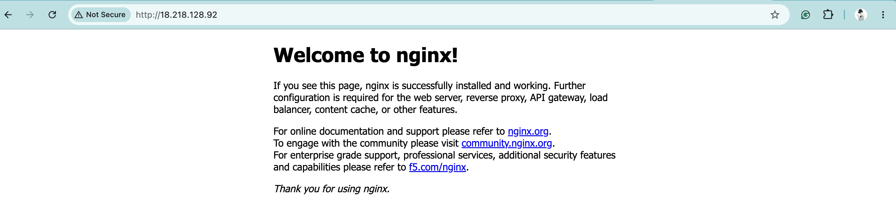

# SRE Take-Home: Nginx Web Server on AWS with Terraform

This project uses Terraform to create a web server in the AWS cloud. It is an EC2 instance running nginx and reachable by HTTP from your own IP address.


## What it creates
- An EC2 instance (`t3.micro`, Amazon Linux 2023).
- A security group with two rules: inbound TCP on port 80 from your IP and all outbound traffic.
- A startup script (`user_data.sh`) that installs and starts nginx.
- A `public_ip` output with the server's IP address.


## Prerequisites
- Create an [AWS Free Tier account](https://aws.amazon.com/free/)
- Install [Terraform](https://developer.hashicorp.com/terraform/tutorials/aws-get-started/install-cli)
- AWS credentials on your machine: an IAM user with EC2 permissions and an access key, set up with `aws configure` using the [AWS CLI](https://docs.aws.amazon.com/cli/). These credentials are needed by Terraform to create resources.


## How to run
Run the commands in a terminal, from the root of this repo.

1. Clone this repo.
2. Create your own `terraform.tfvars` file. Copy `terraform.tfvars.example` and replace the example `my_ip` variable with your public IP address.

    Find your IP using:
    ```
    curl checkip.amazonaws.com
    ```

    The variable should look like `my_ip = "<your_ip>/32"`. The `/32` at the end ensures only your IP can reach the server.
3. Initialize Terraform: 
    ```
    terraform init
    ```
4. Validate the Terraform configuration (optional):
    ```
    terraform validate
    ```
5. Preview the Terraform changes:
    ```
    terraform plan
    ```
6. Create the server:
    ```
    terraform apply
    ```
    Type `yes` to approve if the plan looks correct. This will print the public IP address of your web server (`public_ip` output)
7. Paste the output IP address into your browser to view the nginx page: `http://<public_ip>`.
8. Clean up resources when finished:
    ```
    terraform destroy
    ```


## Result
Pasting the public IP address into your browser should bring you to a page that looks like this:



## Design choices
- **Region:** in the `main.tf` file, my provider region is `us-east-2` because my AWS Free Tier account was assigned this region when created.
- **Instance type and image:** `t3.micro` with Amazon Linux 2023, instead of the suggested `t2.micro` and Amazon Linux 2. `t2.micro` isn’t eligible on my Free Tier account and Amazon Linux 2 reached end of support in June 2026. nginx is installed with `dnf`, the package manager on Amazon Linux 2023.
- **AMI lookup:** a `data "aws_ami"` block finds the image, because AMI IDs differ between regions and change over time.
- **Security group rules:** I defined separate `aws_vpc_security_group_ingress_rule` and `aws_vpc_security_group_egress_rule` resources because the Terraform docs recommend that over the `ingress` and `egress` arguments.
- **Outbound traffic is open to all ports** so the instance can download nginx.
- **`my_ip` is a variable** in a gitignored `terraform.tfvars`, so my IP isn't visible in the public repo.


## Resources used
- [Terraform `aws_instance`](https://registry.terraform.io/providers/hashicorp/aws/latest/docs/resources/instance)
- [Terraform `aws_security_group`](https://registry.terraform.io/providers/hashicorp/aws/latest/docs/resources/security_group)
- [AWS EC2 user data](https://docs.aws.amazon.com/AWSEC2/latest/UserGuide/user-data.html)
- [Terraform outputs tutorial](https://developer.hashicorp.com/terraform/tutorials/configuration-language/outputs)
